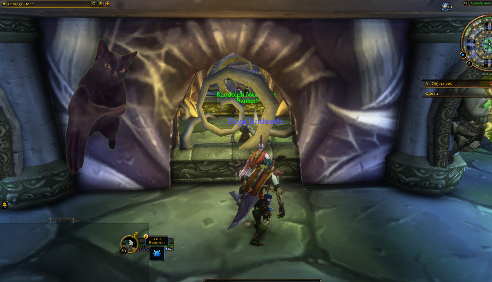
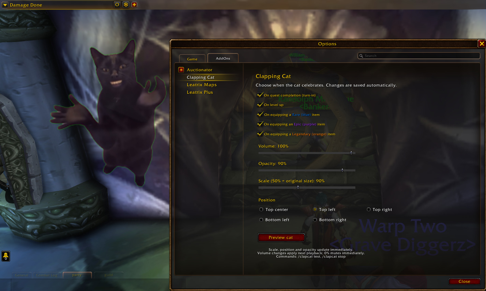

# Clapping Cat for WoW Forever

A little applause for your adventures. Clapping Cat brings the clapping cat meme into WoW Forever with a transparent animation and sound whenever you have something to celebrate.

[Download the latest release](https://github.com/cjorji/wow-clapping-cat/releases/latest) · [Report an issue](https://github.com/cjorji/wow-clapping-cat/issues)

## Features

Choose which moments deserve a round of applause:

- **Quest completion** — celebrate when you turn in a quest.
- **Level up** — mark your next milestone.
- **New equipment** — enable separate triggers for Rare (blue), Epic (purple), and Legendary (orange) items.

Make the cat your own with volume, opacity, and scale controls. Choose from top center, top left, top right, bottom left, or bottom right. Settings are saved automatically and shared across your characters on the same account.

## Download & Installation

1. Go to the [latest release](https://github.com/cjorji/wow-clapping-cat/releases/latest) and download the **ClappingCat-vX.Y.Z.zip** attachment.
2. Exit WoW and copy the **ClappingCat** folder from the ZIP into your client's **Interface/AddOns/** folder.
3. Replace existing addon files if you are updating.
4. Start WoW and enable **Clapping Cat** in the AddOns list.

The installed folder should contain `Interface/AddOns/ClappingCat/ClappingCat.toc`.

## Usage

Type **`/clapcat`** or open **Settings → AddOns → Clapping Cat** to choose your triggers and customize the animation.

| Option | What it does |
| --- | --- |
| Volume | Adjust the clapping from 0–100%. Set it to 0% to mute. Your game's Master volume also applies. |
| Opacity | Adjust visibility from 0–100%. At 0%, the cat is hidden but sound can still play. |
| Scale | Choose 50–150%. 50% is the original size, 100% doubles it, and 150% triples it. |
| Position | Choose one of five screen positions. Top center is the default. |
| Preview cat | Play the animation to try your settings. |

Scale, opacity, and position update immediately during playback. Volume changes apply the next time the cat plays; setting volume to 0% stops the sound immediately.

### Chat commands

| Command | Action |
| --- | --- |
| `/clapcat` | Open the options panel. |
| `/clapcat test` | Preview the cat and sound. |
| `/clapcat stop` | Stop the current animation and sound. |

The cat plays once per celebration. Events during playback share the current celebration so animations and sounds do not stack. Equipment triggers work when equipping an item, including re-equipping gear, whether or not it is an upgrade.

## Compatibility & Support

Built for **WoW Forever**. Compatibility with other WoW versions has not been confirmed.

Occasional blank frames during playback are a known issue. If you encounter a problem, [open an issue](https://github.com/cjorji/wow-clapping-cat/issues) with your addon version, WoW client version, and steps to reproduce it.

## Credits

Animation and sound are based on [the clapping cat clip](https://www.youtube.com/shorts/SX2JLYK6xqg). The original media belongs to its respective rights holders.
